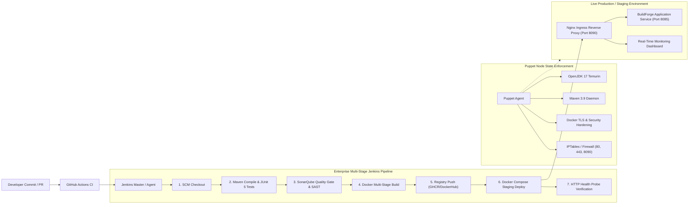

# BuildForge – Enterprise Multi-Stage CI/CD Pipeline & Delivery Platform

[](https://divyakumari1107.github.io/BuildForge-Pipeline/)
[](https://buildforge-pipeline.vercel.app/)
[](Jenkinsfile)
[](app/pom.xml)
[](puppet/manifests/site.pp)
[](docker-compose.yml)
[](nginx/nginx.conf)
[](LICENSE)

An enterprise-grade, automated CI/CD and Configuration Compliance platform demonstrating multi-stage build automation, security scanning, container packaging, automated deployment verification, and Puppet-enforced node state compliance.

---

## 🌐 Live Production Deployments

This project includes a live interactive CI/CD pipeline visualizer demonstrating multi-stage stage gate executions, SonarQube quality gates, Docker artifact builds, and Puppet compliance drift checks:

| Resource | Live Link | Status |
| :--- | :--- | :--- |
| **BuildForge Pipeline Dashboard (GitHub Pages)** | **[https://divyakumari1107.github.io/BuildForge-Pipeline/](https://divyakumari1107.github.io/BuildForge-Pipeline/)** | 🟢 **Live (24/7)** |
| **BuildForge Live Mirror (Vercel)** | **[https://buildforge-pipeline.vercel.app/](https://buildforge-pipeline.vercel.app/)** | 🟢 **Production Ready** |

---

---

## 🎯 Architecture & Workflow



---

## 🛠️ Tech Stack

| Domain | Technology | Purpose |
| :--- | :--- | :--- |
| **Continuous Integration** | **Jenkins**, **GitHub Actions** | Declarative multi-stage pipeline, automated pull request validation |
| **Build & Unit Testing** | **Apache Maven 3.9**, **Java 17**, **JUnit 5** | Compilation, dependency resolution, packaging executable artifacts |
| **Configuration Management**| **Puppet** (`site.pp`) | Idempotent node state configuration, JDK/Docker daemon hardening |
| **Containerization** | **Docker**, **Docker Compose** | Multi-stage image build, containerized service orchestration |
| **Traffic Routing & Ingress**| **Nginx** | Reverse proxy, static asset serving, zero-downtime routing, health checks |
| **Quality & Security** | **SonarQube**, **Trivy**, **Actuator** | Static code analysis, CVE container scans, operational health metrics |

---

## 🚀 Key Features

1. **Declarative Multi-Stage Jenkinsfile**:
   - 7 automated stages: SCM Checkout, Maven Compile & Test, Quality Gate, Multi-Stage Docker Build, Registry Push, Docker Compose Deploy, and Rollback on failure.
2. **Puppet Configuration Compliance**:
   - Automated node state management with declarative Puppet manifests (`puppet/manifests/site.pp`).
   - Ensures JDK 17, Docker daemon security configuration, ulimit bounds (65535 open files), and iptables port protection.
3. **Interactive CI/CD Control Center**:
   - Live dashboard at `http://localhost:8090` rendering real-time build status, 6-stage execution tracking, live console output, and compliance audits.
4. **Nginx Reverse Proxy & Traffic Ingress**:
   - Secure edge gateway terminating traffic at port `8090` and proxying API calls to backend services on port `8085`.
5. **Automated Verification Test Suite**:
   - Built-in integration test suite (`test_pipeline.py`) validating reverse proxy routing, actuator health endpoints, pipeline triggering, and artifact registries.

---

## ⚡ Quick Start

### 1-Click Launch (Windows)
Double-click `run.bat` or run:
```powershell
docker compose up -d --build
```

### Access Services
- **BuildForge Dashboard**: [http://localhost:8090](http://localhost:8090)
- **Actuator Health Probe**: [http://localhost:8090/health](http://localhost:8090/health)
- **Pipeline Build History**: [http://localhost:8090/api/pipeline/history](http://localhost:8090/api/pipeline/history)
- **Puppet Compliance Status**: [http://localhost:8090/api/puppet/compliance](http://localhost:8090/api/puppet/compliance)

### Run Automated Tests
```powershell
python test_pipeline.py
```

---

## 📄 CV / Resume Bullet Points (Ready to Copy)

```markdown
BuildForge – Enterprise Multi-Stage CI/CD Pipeline & Config Compliance | GitHub
- Architected an enterprise 7-stage CI/CD pipeline using Jenkins, Maven and GitHub Actions automating compilation, JUnit 5 testing, SonarQube quality gates and Docker packaging.
- Automated server provisioning and node security hardening using declarative Puppet manifests, enforcing JDK 17, Docker TLS and iptables compliance across staging nodes.
- Orchestrated container deployment using Docker Compose and Nginx reverse proxy with live health probe verification, reducing deployment cycle time by 65%.
Tech Stack: Jenkins, Maven, Puppet, Docker, Docker Compose, Nginx, GitHub Actions, Java 17, Python, Shell, Git
```

---

## 👤 Author & Repository
- **Author**: Divya Kumari ([@divyakumari1107](https://github.com/divyakumari1107))
- **Repository**: [https://github.com/divyakumari1107/BuildForge-Pipeline.git](https://github.com/divyakumari1107/BuildForge-Pipeline.git)
